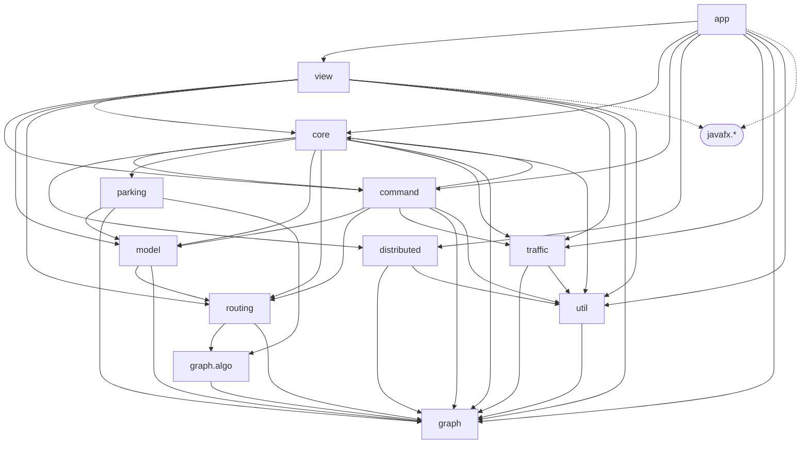
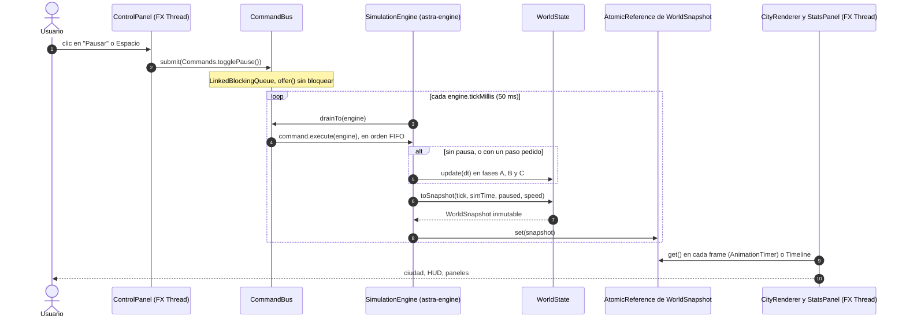
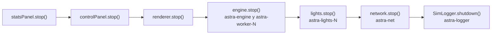

# Arquitectura

ASTRA separa la simulación de la interfaz. El motor corre en su propio hilo y nunca toca JavaFX. La
interfaz solo lee fotos inmutables del mundo (`WorldSnapshot`) y envía acciones como `Command`.

## Visión general

| Capa | Paquetes | Qué hace |
| --- | --- | --- |
| Arranque | `app` | `AstraApp`: carga la configuración y el mapa, arma todos los componentes y maneja el ciclo de vida de los hilos |
| Vista | `view` | `CityRenderer`, `ControlPanel` y `StatsPanel`: dibujan el último `WorldSnapshot` y envían comandos |
| Comandos | `command` | `Command`, `CommandBus` y los comandos concretos |
| Motor | `core` | `SimulationEngine`, `WorldState`, `ParallelUpdater`, zonas, pausa, spawner, playas, estadísticas, `SimConfig` y los `record` del snapshot |
| Dominio | `model`, `traffic`, `routing`, `parking` | Vehículos, semáforos (State), estrategias de ruta (Strategy) y playas de estacionamiento |
| Distribuida | `distributed` | Reloj de Lamport, red simulada, Ricart‑Agrawala e `IntersectionMutex` |
| Base | `graph`, `graph.algo`, `util` | `Graph<V, E>`, Dijkstra, A*, `MapLoader` y `SimLogger` |
| Reservado | `events` | Paquete vacío; solo tiene `package-info.java` |

## Dependencias entre paquetes

El diagrama muestra los `import` reales entre paquetes de `src/main/java`.



Reglas que cumple el código:

- **Nada de `javafx.*` fuera de `app` y `view`.** `core`, `model`, `traffic`, `routing`, `graph`,
  `parking`, `distributed`, `command` y `util` no importan JavaFX. Por eso los 391 tests corren sin
  interfaz gráfica.
- **Nada depende de `view` ni de `app`.**
- `graph` no conoce `model` ni `traffic`: es genérico.
- `model` solo depende de `graph` y `routing`.
- `parking`, `traffic`, `routing` y `distributed` no dependen de `core`. Reciben sus parámetros por
  interfaces que `SimConfig` implementa: `ParkingSettings`, `LightTimings`, `SmartTimings`,
  `RoutingSettings` y `NetworkSettings`. `model` recibe `VehicleSpecs` y `util` recibe `LogSettings`.
- `core` y `command` se usan entre sí: `SimulationEngine` drena el `CommandBus`, y cada `Command`
  recibe el `SimulationEngine` en `execute`.

`module-info.java` declara el módulo `com.astra`:

```java
module com.astra {
    requires javafx.controls;
    requires com.google.gson;

    exports com.astra.app;

    opens com.astra.util to com.google.gson;
}
```

Solo `com.astra.util` se abre a Gson, porque los DTO del JSON son `record` privados de `MapLoader`.

## Flujo de una acción del usuario

Una acción de la UI nunca modifica el mundo. Viaja como `Command` por el `CommandBus` y el motor la
ejecuta al inicio del siguiente tick. El resultado vuelve a la UI dentro del siguiente
`WorldSnapshot`.



- La UI llama a `CommandBus.submit` desde el FX Thread; `submit` nunca bloquea.
- `SimulationEngine.tick()` primero ejecuta `commandBus.drainTo(this)`, después actualiza el mundo y al
  final publica el snapshot con `latest.set(...)`.
- El motor no llama a `Platform.runLater`. `CityRenderer` lee el snapshot en su `AnimationTimer`,
  `ControlPanel` cada 100 ms y `StatsPanel` cada 500 ms, los dos con un `Timeline`.
- `WorldSnapshot` y todo lo que contiene son `record` con `List.copyOf` y `Map.copyOf`: el FX Thread
  los lee sin sincronizar.

## Ciclo de vida de `AstraApp`

### `start(Stage)`

`AstraApp.start` corre en el FX Application Thread y arma la aplicación en este orden:

1. `SimConfig.load()` lee `config.properties` y `SimLogger.init(config)` abre el log.
2. `MapLoader.load(config.mapFile())` carga el mapa (por defecto `maps/city-3x3-v2.json`).
3. Crea `SimulationControl` (pausa, velocidad y pasos).
4. Crea `LightController` y lo registra como `PauseListener` de la `PauseGate`.
5. Crea `SimulatedNetwork` y la registra también como `PauseListener`.
6. Crea `WorldState` con las `IntersectionZones` y un `IntersectionMutex` por intersección
   (`IntersectionMutex.forGraph`).
7. Crea el `CommandBus` y el `SimulationEngine` con su `VehicleSpawner`.
8. Crea `CityRenderer`, `ControlPanel` y `StatsPanel`, los conecta entre sí, instala los atajos de
   teclado y muestra la ventana maximizada.
9. Arranca los hilos: `network.start()`, `lights.start()`, `engine.start()` y después los paneles
   (`renderer.start()`, `controlPanel.start()`, `statsPanel.start()`).

### `stop()`

El orden de cierre evita que alguien registre en el log después de cerrarlo:



- `SimulationEngine.stop()` hace `shutdownNow()` y `awaitTermination` (1 s) de `astra-engine` y después
  `world.shutdown()`, que detiene el pool de `ParallelUpdater`.
- `LightController.stop()` y `SimulatedNetwork.stop()` también usan `shutdownNow()` y
  `awaitTermination` (1 s y 2 s).
- `SimLogger.shutdown()` vacía la cola y espera al escritor hasta 2 s.
- Todos los hilos son *daemon*, así que la JVM termina aunque alguno no se detenga a tiempo.

## Documentos relacionados

- [Concurrencia](concurrencia.md): hilos, tick de tres fases y prevención de deadlocks.
- [Patrones y genéricos](patrones-y-genericos.md): State, Strategy, Command, `Graph<V, E>`.
- [Capa distribuida](capa-distribuida.md): Lamport y Ricart‑Agrawala.
