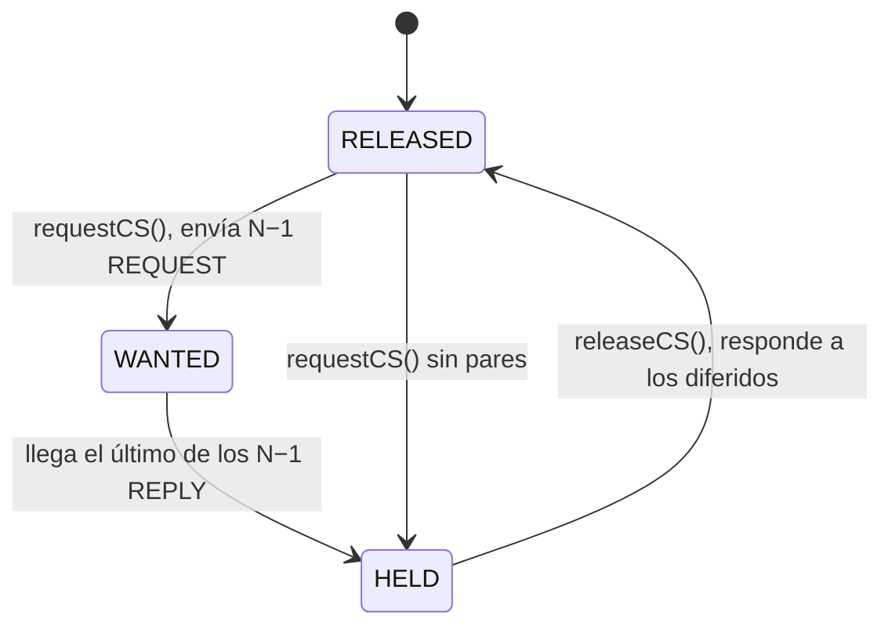
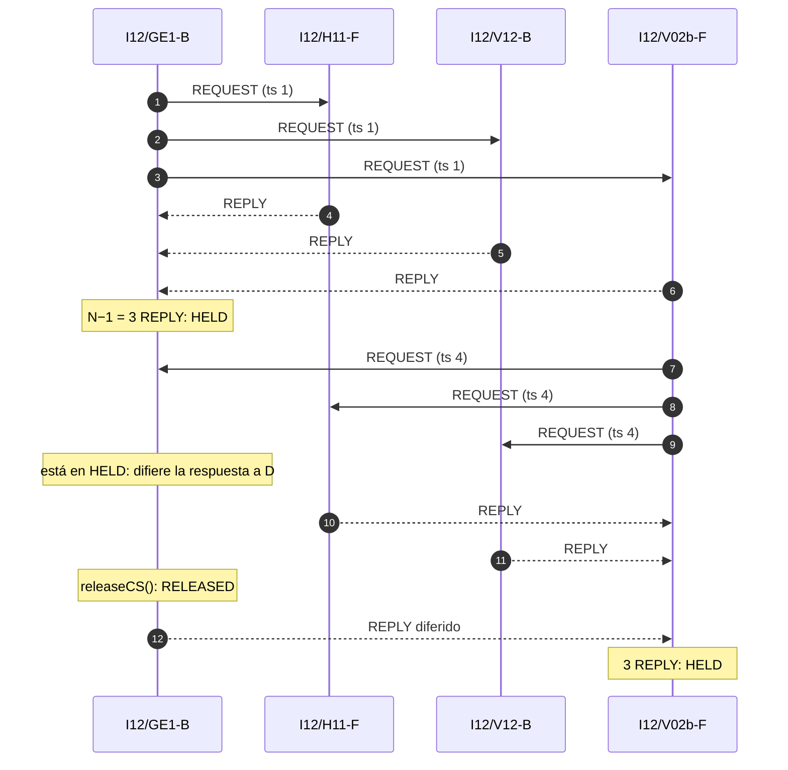

# Capa distribuida

El paquete `distributed` simula procesos que solo se comunican por mensajes. Sirve para reservar la zona
central de cada intersección con **Ricart‑Agrawala** (1981), con relojes lógicos de **Lamport**. No hay
estado compartido entre procesos: cada uno decide con lo que recibe por la red.

| Clase | Rol |
| --- | --- |
| `LamportClock` | Reloj lógico de un proceso |
| `Message`, `MessageType` | Mensaje `REQUEST` o `REPLY` con el timestamp del emisor y el id de la petición |
| `Request` | Petición `(timestamp, processId)` con orden total |
| `SimulatedNetwork`, `MessageHandler`, `NetworkSettings` | Red con latencia aleatoria; entrega en el hilo `astra-net` |
| `RicartAgrawalaNode` | Un proceso de Ricart‑Agrawala |
| `IntersectionMutex` | Un grupo de Ricart‑Agrawala por intersección, con una cola de vehículos por acceso |

## Reloj de Lamport

`LamportClock` es un reloj **por proceso**. Sus tres operaciones son atómicas con un `ReentrantLock`, y
cada evento queda en el log dentro de la sección crítica, así las líneas de un proceso salen en el orden
de su reloj.

| Operación | Regla | Línea de log |
| --- | --- | --- |
| `tick(action)` | `clock = clock + 1` | `[LAMPORT N] PROCESS -> ACTION` |
| `send(action)` | `clock = clock + 1`; el valor devuelto viaja en el mensaje | igual |
| `receive(remoteTs, action)` | `clock = max(clock, remoteTs) + 1` | igual |

`receive` rechaza un `remoteTs` negativo. `LamportClockTest` comprueba la monotonía con varios hilos a
la vez (`concurrentTicksAreDistinctAndConsecutive`) y que un envío ocurre antes que los eventos
posteriores del receptor (`sendHappensBeforeLaterEventsOfReceiver`).

En `RicartAgrawalaNode`, el reloj registra estas acciones: `REQUEST CS`, `RECV REQUEST from <par>`,
`REPLY to <par>` y `RECV REPLY from <par>`.

## Red simulada

`SimulatedNetwork` entrega cada mensaje a su destino tras un retardo aleatorio.

- **Latencia.** Uniforme entre `distributed.latencyMinMillis` (5) y `distributed.latencyMaxMillis` (40),
  ambos incluidos, en milisegundos reales.
- **Semilla.** `distributed.seed` (7) hace reproducible el sorteo de latencias. El orden de llegada
  también depende de cuándo se envía cada mensaje, que depende de la carga de los hilos.
- **Sin orden FIFO.** Dos mensajes del mismo emisor pueden llegar al revés
  (`SimulatedNetworkTest.messagesFromSameSenderMayArriveOutOfOrder`). Ricart‑Agrawala no lo necesita: el
  orden lo decide el timestamp de cada `Request`.
- **Un solo hilo.** Todas las entregas, y por tanto todos los `MessageHandler`, corren en `astra-net`.
- **Pausa.** `onPause()` retiene los mensajes que cumplen su latencia; `onResume()` los entrega enseguida
  porque su retardo ya pasó.
- **Fallos.** Un destino desconocido o una red detenida descartan el mensaje con un `WARN` en la
  categoría `NET`. Un handler que lanza una excepción cuenta como entregado.
- **Contadores.** `sentCount()`, `deliveredCount()` e `inFlightCount()` llegan al snapshot como
  `NetworkView`, y `StatsPanel` los muestra como "Mensajes enviados" y "Mensajes en vuelo".

## Ricart‑Agrawala por paso de mensajes

Cada `RicartAgrawalaNode` tiene tres estados:



Al recibir un `REQUEST`, un nodo **difiere** su respuesta si está en `HELD`, o si está en `WANTED` y su
propia petición es anterior según `Request` (menor `timestamp`; si empatan, menor `processId`). Si no,
responde enseguida. Al salir de la sección (`releaseCS`) envía un `REPLY` a cada par diferido.



El diagrama sigue la traza real que aparece más abajo.

- **Costo.** Cada entrada cuesta exactamente **2(N − 1) mensajes**: N − 1 `REQUEST` y N − 1 `REPLY`.
  `RicartAgrawalaTest.singleEntryCostsTwoNMinusOneMessages` y
  `fourNodesNeverOverlapAllFinishAndPayTwoNMinusOneMessages` lo comprueban con `network.sentCount()`.
- **Un pedido a la vez.** `requestCS` lanza `IllegalStateException` si el nodo no está en `RELEASED`, y
  `releaseCS` si no está en `HELD`.
- **REPLY obsoleto.** Un `REPLY` que no corresponde a la petición en curso se ignora con un `WARN`.
- **Locks.** El estado se protege con un `ReentrantLock`. Los mensajes se preparan dentro del lock y se
  envían fuera; las líneas `[RICART]` se registran dentro, en el orden en que cambió el estado.

Líneas de evidencia (formato estable, lo usa el informe):

```text
[RICART] <proceso> requested access at <ts>
[RICART] <proceso> ENTERED critical section
[RICART] <proceso> released critical section
```

## `IntersectionMutex`: cada acceso es un proceso

`IntersectionMutex.forGraph(graph, network)` crea un mutex por cada nodo del grafo que tiene al menos
una vía entrante. Dentro de un mutex, **cada vía entrante es un proceso** con id
`"<intersectionId>/<roadId>"` (por ejemplo `I12/GE1-B`), y sus pares son los demás accesos de la misma
intersección.

En `city-3x3-v2.json` hay 29 mutex y 64 procesos:

| Nodos | Vías entrantes (N) | Mensajes por entrada, 2(N − 1) |
| --- | --- | --- |
| 9 `INTERSECTION` (`I00` … `I22`) | 4 | 6 |
| 4 `JUNCTION` (`J00`, `J01`, `J10`, `J11`) | 3 | 4 |
| 12 `GATEWAY` y 4 `PARKING` | 1 | 0: el proceso no tiene pares y entra directamente |

Cada acceso tiene una cola FIFO de vehículos (`ConcurrentLinkedQueue`) y **solo el primero** compite por
la sección, con un pedido a la vez por nodo. La API no bloquea al motor:

| Método | Qué hace |
| --- | --- |
| `enqueue(road, vehicleId)` | Pone al vehículo al final de la cola de su acceso; si es el primero y el acceso está en `RELEASED`, pide la sección |
| `isGranted(vehicleId)` | `true` si es el primero de su cola y su acceso está en `HELD` |
| `release(vehicleId)` | El vehículo salió de la zona: libera la sección y, si quedan vehículos, pide la siguiente entrada |
| `cancel(vehicleId)` | Lo saca de la cola; si tenía la sección, la libera |
| `holder()`, `waiting()` | Quién tiene la sección y quiénes esperan; van al snapshot como `MutexView` |

Si el primero de la cola cancela mientras su acceso espera los `REPLY`, el pedido sigue en curso: al
entrar, la sección pasa al nuevo primero, o se libera enseguida si la cola quedó vacía (callback
`onEnter`, que corre en `astra-net`).

## Modos `SEMAPHORE` y `RICART_AGRAWALA`

`distributed.mutex` elige el modo al arrancar (`SEMAPHORE` por defecto) y `SetMutexModeCmd` lo cambia
en vivo desde la sección "Exclusión" del panel de control.

| | `SEMAPHORE` | `RICART_AGRAWALA` |
| --- | --- | --- |
| Para cruzar hace falta | Un permiso del `Semaphore` de la `IntersectionZone` (capacidad `intersection.capacity` = 2) | La sección crítica del `IntersectionMutex` **y además** el permiso de la zona |
| Quién puede entrar a la zona | Cualquier vehículo, hasta 2 a la vez | Solo el primero de la cola del acceso que tiene la sección; el siguiente pide entrada cuando ese sale del box |
| Mensajes por la red | Ninguno | 2(N − 1) por entrada |
| En el mapa | Contorno naranja si la zona está llena | Además, un candado por cruce: contorno si está libre, relleno con el id del vehículo si alguien la tiene |

En modo `RICART_AGRAWALA`, `WorldState` aplica estas reglas en la fase A del tick:

1. Un vehículo se encola **una sola vez**, cuando ya podría cruzar por las demás reglas: la luz lo deja,
   está cerca de la línea y hay espacio en la vía siguiente.
2. Solo cruza si `isGranted` es `true` y además consigue la zona con `tryEnter`.
3. Si tiene la sección pero no logra entrar durante `distributed.grantTimeoutTicks` (60) ticks, la suelta
   con `cancel` y vuelve a encolarse.
4. Si su luz deja de permitirle cruzar, sale de la cola.
5. Al salir del box (fase C) llama a `release`.
6. Los vehículos que nacen en el centro de una intersección no cruzan desde ningún acceso: no pasan por
   Ricart‑Agrawala.

Al cambiar de modo, `WorldState.setMutexMode` cancela todas las peticiones pendientes entre dos ticks;
los vehículos que ya están dentro de una zona terminan de cruzar con su permiso de capacidad.

## Traza real

La siguiente traza sale de una ejecución corta y headless del motor con la configuración por defecto y
`distributed.mutex=RICART_AGRAWALA`: 60 s reales a velocidad ×1 (1200 ticks), con 36 vehículos
generados y 183 mensajes enviados y entregados. Se ejecutó con un programa temporal que arma los mismos
componentes que `AstraApp.start`, sin la interfaz; ese programa no está en el repositorio (ver
**Pendiente** abajo). El log completo tuvo 309 líneas `[LAMPORT]` y 96 `[RICART]`.

Son todas las líneas de la intersección `I12` hasta la segunda entrada, tal como salieron del log
(el número de la izquierda es la línea del archivo; las líneas de otras intersecciones se omiten):

```text
227  [LAMPORT 1] I12/GE1-B -> REQUEST CS
228  [RICART] I12/GE1-B requested access at 1
229  [LAMPORT 2] I12/H11-F -> RECV REQUEST from I12/GE1-B
230  [LAMPORT 3] I12/H11-F -> REPLY to I12/GE1-B
231  [LAMPORT 2] I12/V12-B -> RECV REQUEST from I12/GE1-B
232  [LAMPORT 3] I12/V12-B -> REPLY to I12/GE1-B
233  [LAMPORT 4] I12/GE1-B -> RECV REPLY from I12/H11-F
234  [LAMPORT 2] I12/V02b-F -> RECV REQUEST from I12/GE1-B
235  [LAMPORT 3] I12/V02b-F -> REPLY to I12/GE1-B
236  [LAMPORT 5] I12/GE1-B -> RECV REPLY from I12/V02b-F
237  [LAMPORT 6] I12/GE1-B -> RECV REPLY from I12/V12-B
238  [RICART] I12/GE1-B ENTERED critical section
328  [LAMPORT 4] I12/V02b-F -> REQUEST CS
329  [RICART] I12/V02b-F requested access at 4
330  [LAMPORT 5] I12/H11-F -> RECV REQUEST from I12/V02b-F
331  [LAMPORT 6] I12/H11-F -> REPLY to I12/V02b-F
332  [LAMPORT 7] I12/GE1-B -> RECV REQUEST from I12/V02b-F
333  [LAMPORT 5] I12/V12-B -> RECV REQUEST from I12/V02b-F
334  [LAMPORT 6] I12/V12-B -> REPLY to I12/V02b-F
335  [LAMPORT 7] I12/V02b-F -> RECV REPLY from I12/H11-F
336  [LAMPORT 8] I12/V02b-F -> RECV REPLY from I12/V12-B
346  [RICART] I12/GE1-B released critical section
347  [LAMPORT 8] I12/GE1-B -> REPLY to I12/V02b-F
350  [LAMPORT 9] I12/V02b-F -> RECV REPLY from I12/GE1-B
351  [RICART] I12/V02b-F ENTERED critical section
```

Cómo leerla:

- `I12` tiene 4 accesos, así que N = 4. Cada entrada usa 1 `REQUEST CS` que sale a 3 pares y 3 `REPLY`:
  6 mensajes, es decir 2(N − 1).
- En la línea 332, `I12/GE1-B` recibe el `REQUEST` de `I12/V02b-F` mientras está en `HELD` y **no**
  responde. Solo responde en la línea 347, justo después de liberar la sección (línea 346).
- Los relojes son por proceso: la línea 332 (`LAMPORT 7`) aparece antes que la 333 (`LAMPORT 5`) porque
  son relojes de procesos distintos.
- La regla de `receive` se ve en la línea 332: `I12/GE1-B` tenía su reloj en 6 y recibe un timestamp 4,
  así que pasa a `max(6, 4) + 1 = 7`.

Para obtener una traza propia: abre la aplicación, elige **Ricart‑Agrawala** en la sección "Exclusión"
y revisa `logs/astra.log` (las líneas `[LAMPORT]` y `[RICART]` se escriben con cualquier `log.level`).

## Pendiente

- Un runner de escenarios versionado (por ejemplo `ScenarioRunner`) que reproduzca esta traza sin
  interfaz. No existe en el código.
- La carpeta `docs/report/evidence/` con los logs de evidencia para el informe. No existe.
