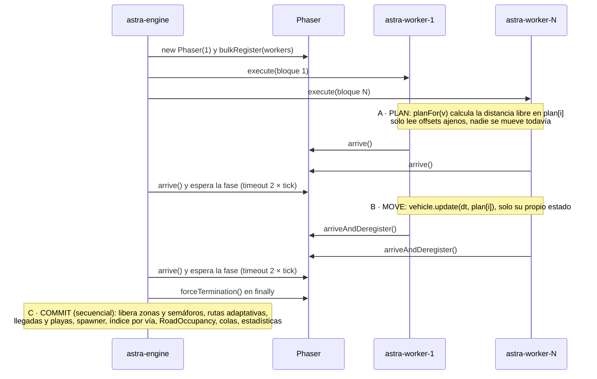
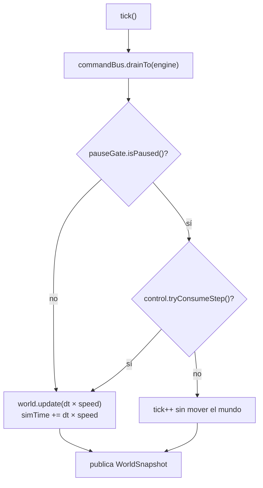

# Concurrencia

ASTRA reparte el trabajo entre varios hilos con nombre. La regla central es que **el mundo tiene un
único dueño**, el hilo `astra-engine`. Los demás hilos leen fotos inmutables o se comunican por colas y
estructuras concurrentes.

## Hilos

| Hilo | Quién lo crea | Qué hace | Qué puede tocar |
| --- | --- | --- | --- |
| JavaFX Application Thread | JavaFX | `AstraApp.start/stop`, dibujo (`AnimationTimer` de `CityRenderer`), refresco de `ControlPanel` (100 ms) y `StatsPanel` (500 ms) | Nodos JavaFX, `CommandBus.submit()`, lectura de `engine.latestSnapshot()` |
| `astra-engine` | `SimulationEngine` (`newSingleThreadScheduledExecutor`, `scheduleAtFixedRate`) | Bucle de paso fijo cada `engine.tickMillis` (50 ms): drena comandos, actualiza el mundo y publica el `WorldSnapshot` | `WorldState` (dueño exclusivo), `VehicleSpawner`, `ParkingService`, `SimStats` |
| `astra-worker-1` … `astra-worker-N` | `ParallelUpdater` (`newFixedThreadPool`, `engine.workers`, 4 por defecto) | Fases A (PLAN) y B (MOVE) de un bloque de vehículos dentro del tick | Su bloque de vehículos; `IntersectionZone.tryEnter`, `TrafficLight.preempt`, las entradas propias de los mapas concurrentes de `WorldState`, `IntersectionMutex` |
| `astra-lights-1`, `astra-lights-2` | `LightController` (`newScheduledThreadPool(2)`) | Transiciones programadas de cada `TrafficLight` | El estado de su `TrafficLight`; lee las colas con `QueueSensor` (sin bloquear) |
| `astra-net` | `SimulatedNetwork` (`newSingleThreadScheduledExecutor`) | Entrega los mensajes REQUEST/REPLY tras su latencia; corre todos los `MessageHandler` | Estado de cada `RicartAgrawalaNode` (con su lock) y el callback de entrada de `IntersectionMutex` |
| `astra-logger` | `SimLogger` (un `Thread` daemon por `Sink`) | Toma las líneas de su `LinkedBlockingQueue` y las escribe en `logs/astra.log` y en la consola | Su cola y el archivo de log |

Todos los hilos son *daemon* y se detienen en `AstraApp.stop()` con `shutdownNow()` y
`awaitTermination` (ver [Arquitectura](arquitectura.md#stop)).

## Tick de tres fases

`WorldState.update(dt)` divide cada tick en tres fases. Con `engine.parallel=true` las fases A y B
corren en `ParallelUpdater`; con `false`, en un bucle secuencial dentro de `astra-engine`. La fase C
siempre es secuencial.

### A · PLAN

Cada vehículo calcula `plan[i] = freeDistance(...)`: cuánto puede avanzar sin chocar con el de adelante,
pasarse una luz o entrar a una zona llena (ver [Simulación](simulacion.md)). Lee las posiciones de los
demás desde el índice por vía (`byRoad`), que no cambia hasta la fase C. Como nadie se mueve hasta la
fase B, no hay carreras de datos aunque un worker lea vehículos ajenos.

Lo único que escribe en esta fase es estado concurrente:

- `IntersectionZone.tryEnter` (un `Semaphore`).
- `TrafficLight.preempt` de las ambulancias (con el lock del semáforo).
- `entryClaims.putIfAbsent` (`ConcurrentHashMap`): la primera vía que reserva una vía de salida en el
  tick gana.
- Las entradas del propio vehículo en `held`, `preempted`, `raQueued`, `grantTicks` y `raCrossings`
  (`ConcurrentHashMap`).
- En modo `RICART_AGRAWALA`, `IntersectionMutex.enqueue/cancel` (con su lock; nunca bloquea en la red).

### B · MOVE

Cada vehículo aplica `update(dt, plan[i])` y solo modifica su propio estado (posición, velocidad,
tiempo de viaje y de espera).

### C · COMMIT

En `astra-engine`, en orden de la lista de vehículos: libera la zona de quien salió del box
(`intersection.boxLength`), suelta la sección de Ricart‑Agrawala y la preferencia de la ambulancia,
recalcula las rutas adaptativas, elimina a quien llegó (o lo entrega a `ParkingService`), devuelve a la
calle a los que terminan su estancia, ejecuta el `VehicleSpawner`, reconstruye el índice por vía y
publica la nueva `RoadOccupancy` y las colas por eje en `AtomicReference`.

### Garantías de `ParallelUpdater`

- Reparte los índices en exactamente `workers` bloques, uno por hilo del pool: todas las tareas corren
  a la vez y ninguna espera en la barrera a otra sin hilo.
- El motor y las tareas se registran en el `Phaser` **antes** de enviarlas, así ninguna fase avanza sin
  todas.
- Si una tarea falla, igual llega al `Phaser` (no lo deja colgado) y, si el fallo fue en PLAN, nadie
  ejecuta MOVE. El motor relanza la excepción al terminar la fase.
- Cada fase tiene un timeout de 2 × `engine.tickMillis` (100 ms por defecto); si vence, el motor lanza
  `IllegalStateException` con el nombre de la fase. `forceTermination()` en el `finally` libera a
  cualquier tarea que siga esperando.
- El `Phaser` da la relación *happens-before* entre lo que escriben los workers y la fase C.

En paralelo los workers compiten de verdad por las zonas, así que dos ejecuciones con la misma semilla
pueden diferir en el orden de llegada. En modo secuencial son idénticas (lo comprueban
`VehicleSpawnerTest.sameSeedGivesSameCounts` y `ParkingIntegrationTest.sequentialRunsWithTheSameSeedParkIdentically`).

## Pausa sin bloquear el motor

`PauseGate` usa un `ReentrantLock` y una `Condition`. El motor **nunca espera** en ella: solo consulta
`isPaused()`. Si se bloqueara, no podría drenar el `ResumeCmd` que la reanuda.

- En pausa, el tick sigue avanzando y se publican snapshots con `paused=true`, pero el tiempo simulado
  no avanza. `StepCmd` pide pasos sueltos con `SimulationControl.requestSteps(n)`.
- `PauseGate` avisa a sus `PauseListener` **fuera del lock**:
  - `LightController.pause()` cancela la tarea programada de cada `TrafficLight` y guarda lo que le
    faltaba; `resume()` la reprograma con ese tiempo.
  - `SimulatedNetwork.onPause()` retiene los mensajes que cumplen su latencia y `onResume()` los
    entrega enseguida.
- Las estancias en las playas y las estadísticas se miden en tiempo simulado, así que la pausa las
  congela.
- `awaitResumed(timeout)` existe solo para hilos que pueden bloquearse (tests); nunca lo llama
  `astra-engine`.

La velocidad (`SetSpeedCmd`, ×0.25 a ×4) multiplica el `dt` de cada tick. Los semáforos dividen cada
duración por la velocidad al programar la fase siguiente, así que el cambio se nota desde la próxima
transición. La latencia de la red simulada está en milisegundos reales y no depende de la velocidad.

## Zonas de cruce: `IntersectionZone`

Cada nodo del grafo tiene una `IntersectionZone` con capacidad `intersection.capacity` (2 por
defecto): un `Semaphore` justo y un conjunto concurrente de ocupantes.

- `tryEnter(vehicleId)` usa solo `tryAcquire()`. Si el vehículo ya estaba dentro devuelve `true` sin
  tomar otro permiso; si otro hilo lo agregó a la vez, devuelve el permiso sobrante.
- `leave(vehicleId)` es idempotente: solo libera si el vehículo estaba dentro.
- **Nunca** se usa `acquire()` bloqueante dentro de un tick: congelaría el motor y podría causar
  deadlocks. Un vehículo que no consigue el permiso simplemente se detiene en la línea y lo reintenta en
  el tick siguiente.

## Cajones de las playas: `ResourcePool<T>`

`ParkingLot` guarda sus cajones en un `ResourcePool<String>`: un `Semaphore` justo cuenta los lugares
libres y un arreglo de slots, protegido por su propio monitor, recuerda qué vehículo ocupa cada uno.

- `tryAcquire(item)` no bloquea: devuelve el índice del cajón o vacío si no hay lugar. Un mismo `item`
  ocupa a lo sumo un cajón.
- `release(item)` es idempotente.
- El semáforo y los slots siempre coinciden: con un permiso hay un slot libre (si no, lanza
  `IllegalStateException`).
- En la simulación lo usa solo `astra-engine`: en la fase C y al leer los slots para armar los
  `ParkingView` del snapshot; `ResourcePoolTest.twentyThreadsNeverExceedCapacity`
  lo prueba con 20 hilos.

## Cómo se evitan los deadlocks

1. **Sin esperas bloqueantes en el tick.** Zonas y cajones usan `tryAcquire`; `IntersectionMutex`
   expone una API no bloqueante (`enqueue`, `isGranted`, `release`, `cancel`).
2. **El motor nunca espera la pausa.** Solo consulta `isPaused()`.
3. **Listeners fuera del lock.** `PauseGate` notifica después de soltar su lock, así el lock del semáforo
   y el de la compuerta nunca forman un ciclo.
4. **El lock de `TrafficLight` es siempre el último.** Con él tomado solo se llama a `schedule` y
   `cancel` del executor, que nunca vuelven a entrar al semáforo. Una transición cancelada que ya
   empezó se descarta con un contador de generación.
5. **Orden fijo en la capa distribuida.** `IntersectionMutex` toma su lock y después el del nodo.
   `RicartAgrawalaNode` prepara los mensajes dentro de su lock y los envía fuera, y llama al callback de
   entrada sin el lock; así `astra-net` entra a `IntersectionMutex` sin tener el lock de un nodo.
6. **Un solo hilo para los handlers.** Todos los `MessageHandler` corren en `astra-net`, nunca en
   paralelo entre sí, y no se bloquean.
7. **Fases con timeout.** El `Phaser` de `ParallelUpdater` tiene timeout por fase y `forceTermination`.
8. **Logger sin bloqueo.** `SimLogger` solo encola; el disco lo toca `astra-logger`.
9. **Monitores siempre en el mismo orden.** El único anidamiento es `SimulationEngine.stop()`, que con
   el monitor del motor llama a `ParallelUpdater.shutdown()`; `ParallelUpdater.run` nunca toma el
   monitor del motor. Los demás `synchronized` (historial de `CommandBus`, slots de `ResourcePool`,
   ciclo de vida de `SimulatedNetwork` y de `SimLogger`) no llaman a otro monitor.

`EngineStressTest` y `DistributedCrossingTest` llevan 150 vehículos durante 3000 ticks sin deadlock
(ver [Pruebas](pruebas.md)).

## Estructuras thread-safe

| Estructura | Dónde | Para qué |
| --- | --- | --- |
| `AtomicReference<WorldSnapshot>` | `SimulationEngine.latest` | Publicar la foto del mundo para la UI |
| `AtomicReference<LightState>` | `TrafficLight.state` | Leer el color sin bloquear desde cualquier hilo |
| `AtomicReference<RoadOccupancy>`, `AtomicReference<Map<…>>` | `WorldState.occupancy`, `WorldState.queues` | Ocupación por vía (rutas) y cola por eje (`QueueSensor` de los semáforos) |
| `LinkedBlockingQueue<Command>` | `CommandBus` | Cola UI → motor |
| `LinkedBlockingQueue<String>` | `SimLogger` | Cola de líneas hacia `astra-logger` |
| `ConcurrentHashMap` | `WorldState` (`held`, `preempted`, `entryClaims`, `raQueued`, `grantTicks`, `raCrossings`), `IntersectionZones`, `Graph`, `RoadGraph`, `SimulatedNetwork.handlers`, `IntersectionMutex.vehicles` | Escrituras de los workers en la fase A y registros leídos desde varios hilos |
| `ConcurrentHashMap.newKeySet()` | `IntersectionZone.occupants`, `TrafficLight.preemptors` | Conjuntos de ocupantes y de ambulancias que pidieron verde |
| `CopyOnWriteArrayList` | `Graph` (listas de adyacencia), `PauseGate.listeners` | Lecturas frecuentes, escrituras raras |
| `ConcurrentLinkedQueue<String>` | `IntersectionMutex` (cola FIFO de cada acceso) | Cola de vehículos por vía entrante |
| `Semaphore` (justo) | `IntersectionZone`, `ResourcePool` | Capacidad de zonas y cajones con `tryAcquire` |
| `ReentrantLock` | `PauseGate` (+ `Condition`), `TrafficLight`, `LamportClock`, `RicartAgrawalaNode`, `IntersectionMutex`, `SimulatedNetwork` | Secciones críticas cortas |
| `Phaser` | `ParallelUpdater` | Separar PLAN de MOVE |
| `AtomicLong`, `AtomicInteger`, `AtomicLongArray` | Contadores de `CommandBus`, `SimulatedNetwork`, `TrafficLight`, `ParkingLot`, `SimulationControl`, `SimLogger` | Contadores sin lock |
| `volatile` | `WorldState.mutexMode`, `LightController.mode`, `SimulationControl.speedFactor`, `ParkingLot.open` | Banderas que se leen desde otros hilos |

El proyecto no usa `PriorityBlockingQueue`; las colas de prioridad son `PriorityQueue` locales de
Dijkstra y A* (ver [Patrones y genéricos](patrones-y-genericos.md#colas-de-prioridad)).
