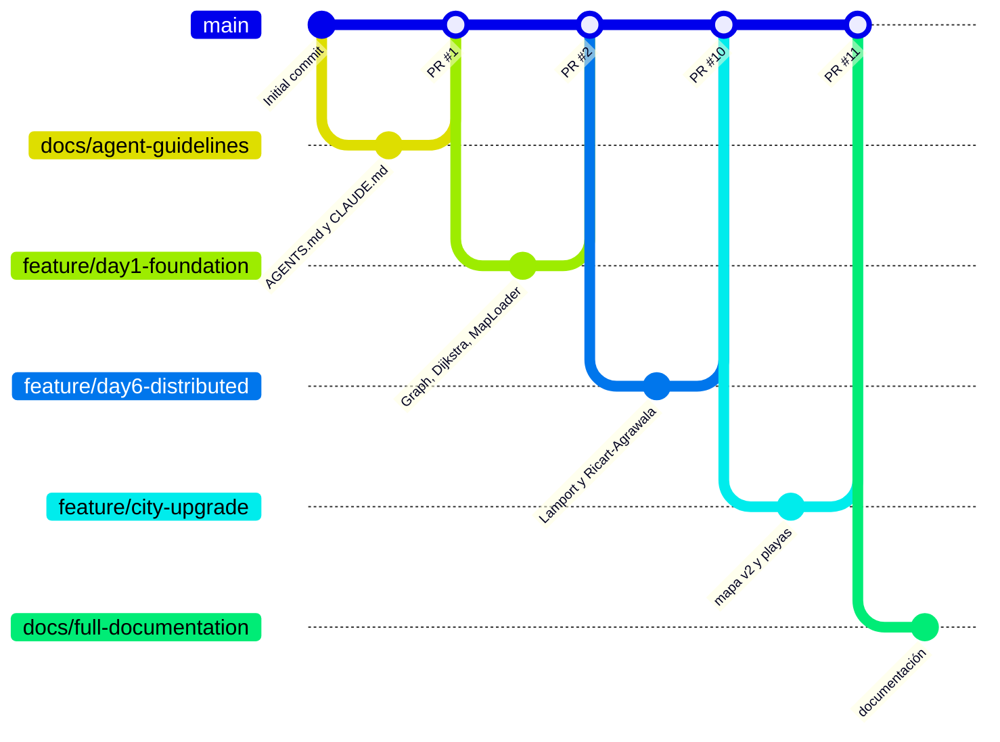

# Cómo contribuir

Las reglas completas del proyecto están en [AGENTS.md](../AGENTS.md); las indicaciones para Claude Code,
en [CLAUDE.md](../CLAUDE.md). Este documento resume el flujo que el equipo usa de verdad, según el
historial de Git.

## Flujo Git



(El diagrama resume: entre el PR #2 y el #10 hubo otros siete PR con el mismo esquema).

- **`main`** es la rama estable y la de integración. Hoy no existe `develop`: aunque
  [AGENTS.md](../AGENTS.md#11-flujo-git) la describe, todas las ramas de trabajo salen de `main` y
  vuelven a `main`.
- **Una rama por tema**, con prefijo: `feature/<tema>`, `fix/<tema>`, `chore/<tema>`, `docs/<tema>` y
  `test/<tema>`.
- **Pull Request en GitHub** para integrar, con un commit de merge (`Merge pull request #N from ...`).

| PR | Rama | Contenido |
| --- | --- | --- |
| #1 | `docs/agent-guidelines` | `AGENTS.md` y `CLAUDE.md` |
| #2 | `feature/day1-foundation` | Día 1: Maven y JavaFX, `SimConfig`, `Graph<V, E>`, Dijkstra y `MapLoader` |
| #3 | `feature/day2-engine-render` | Día 2: `WorldSnapshot`, `Vehicle`, motor de paso fijo y renderizado |
| #4 | `feature/day3-traffic-lights` | Día 3: semáforos con State y zonas con `Semaphore` |
| #5 | `chore/windows-exe` | `build-exe.bat` |
| #6 | `fix/intersection-rules` | Correcciones en semáforos e intersecciones |
| #7 | `feature/day4-routing-vehicles` | Día 4: A*, estrategias de ruta, Bus, Ambulance, spawner y `ParallelUpdater` |
| #8, #9 | `feature/day5-commands-ui` | Día 5: `CommandBus`, comandos, pausa, SMART, estadísticas y paneles |
| #10 | `feature/day6-distributed` | Día 6: `SimLogger`, Lamport, red simulada, Ricart‑Agrawala y su integración |
| #11 | `feature/city-upgrade` | Mapa v2 con gateways y playas, nueva vista y paquete `parking` |

La rama `feature/parked-cars` existe en el remoto con tres commits que todavía no están en `main`
(dibujar los autos estacionados); su contenido no está documentado aquí.

### Pasos

```bash
git switch main
git pull
git switch -c feature/<tema>
# ... cambios, cada uno con su commit ...
mvn clean test
git push -u origin feature/<tema>
# abrir el Pull Request hacia main en GitHub
```

Los agentes de IA trabajan solo en la rama actual: pueden hacer `git add` y `git commit`, pero el push
y los Pull Request los hace una persona (ver [CLAUDE.md](../CLAUDE.md)).

## Formato de los commits

[Conventional Commits](https://www.conventionalcommits.org/):

```text
type(scope): descripción
```

- `type` y `scope` en **inglés**; la descripción en **español**, en imperativo, sin punto final y de
  máximo 72 caracteres.
- `type`: `feat`, `fix`, `refactor`, `test`, `docs`, `chore`, `style`, `perf` y `build`.
- `scope`: el paquete o el área, por ejemplo `graph`, `core`, `model`, `traffic`, `routing`, `command`,
  `distributed`, `parking`, `view`, `util`, `config` o `report`.
- El cuerpo (opcional) va en español y explica el porqué del cambio.
- Un commit es un cambio lógico que compila y pasa los tests.

Ejemplos del historial:

```text
feat(distributed): agrega reloj de Lamport por proceso
test(core): agrega prueba de cruce distribuido con 150 vehículos
feat(parking): agrega ResourcePool genérico con Semaphore y cajones
```

Los commits de los Días 1 a 5 son anteriores a esta convención: muchos no tienen scope (por ejemplo
`feat: agregar grafo generico`).

## Definition of Done

- [ ] `mvn clean test` termina en `BUILD SUCCESS`.
- [ ] `mvn javafx:run` abre la app y el cambio se ve o funciona.
- [ ] No hay imports de `javafx.*` fuera de `app` y `view`.
- [ ] No hay números mágicos nuevos: van a `config.properties`, con su getter en `SimConfig` (ver
  [Configuración](configuracion.md)).
- [ ] Los logs `[LAMPORT]` y `[RICART]` no cambian de formato si se tocó la capa distribuida.
- [ ] Las clases nuevas de `graph`, `traffic`, `routing`, `command` y `distributed` tienen su test
  JUnit 5 en el mismo commit o en el siguiente.
- [ ] Todo método nuevo que toca estado compartido indica en su Javadoc qué hilo lo llama
  (`@implNote Called from astra-engine`).
- [ ] El commit sigue el formato de arriba y está en la rama correcta.
