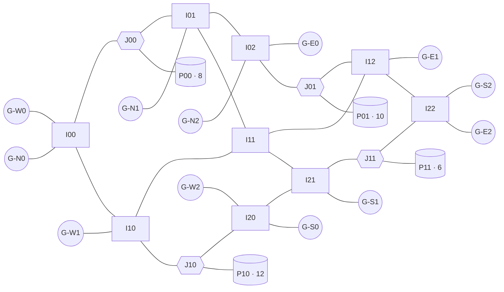

# Mapas

Los mapas son archivos JSON en `src/main/resources/com/astra/maps/`. La clave `map.file` de
`config.properties` indica cuál se carga, con una ruta relativa a `src/main/resources/com/astra/`
(por defecto `maps/city-3x3-v2.json`). `MapLoader` los lee con Gson y los convierte en un `RoadGraph`.

## Formato

```json
{
  "name": "Nombre del mapa",
  "bounds": {"width": 1200, "height": 900},
  "intersections": [
    {"id": "I00", "x": 300, "y": 150},
    {"id": "G-N0", "x": 300, "y": 0, "kind": "GATEWAY"},
    {"id": "P00", "x": 450, "y": 220, "kind": "PARKING", "capacity": 8}
  ],
  "roads": [
    {"id": "GN0", "from": "G-N0", "to": "I00", "speedLimit": 14, "lanes": 1, "twoWay": true}
  ]
}
```

### Raíz

| Campo | Obligatorio | Descripción |
| --- | --- | --- |
| `name` | Sí | Nombre del mapa; aparece en el título de la ventana |
| `bounds` | No | Tamaño del lienzo: `{"width", "height"}`, los dos mayores que 0. Si falta, se calcula (ver abajo) |
| `intersections` | Sí | Lista de nodos; no puede estar vacía |
| `roads` | Sí | Lista de vías; no puede estar vacía |

### Nodos (`intersections`)

| Campo | Obligatorio | Descripción |
| --- | --- | --- |
| `id` | Sí | Único y no vacío |
| `x`, `y` | Sí | Coordenadas en px, finitas y dentro de `[0, width] × [0, height]`. `y` crece hacia abajo |
| `kind` | No | `INTERSECTION` (por defecto), `GATEWAY`, `JUNCTION` o `PARKING`; no distingue mayúsculas |
| `capacity` | Solo `PARKING` | Cajones de la playa, `>= 1`. Ningún otro tipo puede tenerla |

| `kind` | Qué representa | Semáforo |
| --- | --- | --- |
| `INTERSECTION` | Cruce de calles | Sí, si le entran 3 o más vías de los dos ejes |
| `GATEWAY` | Entrada y salida de la ciudad en el borde | No |
| `JUNCTION` | Punto a mitad de cuadra del que sale la entrada de una playa | No |
| `PARKING` | Playa de estacionamiento, sin salida | No |

### Vías (`roads`)

| Campo | Obligatorio | Descripción |
| --- | --- | --- |
| `id` | Sí | Único y no vacío |
| `from`, `to` | Sí | Ids de nodos existentes y distintos entre sí |
| `speedLimit` | Sí | Velocidad máxima en px/s, mayor que 0 |
| `lanes` | Sí | Número de carriles, `>= 1`; entra en el cálculo de la ocupación de la vía |
| `twoWay` | No | Con `true` crea dos vías dirigidas: `<id>-F` (`from` → `to`) y `<id>-B` (`to` → `from`). Si falta o es `false`, la vía es de un solo sentido y conserva su `id` |
| `length` | No | Largo en px, mayor que 0. Si falta, es la distancia euclidiana entre los nodos. Para que A* encuentre la ruta óptima, no debería ser menor que esa distancia |

## Ejemplo mínimo válido

Este mapa tiene dos gateways, un cruce, un punto a mitad de cuadra y una playa de 4 cajones. Se
comprobó con `MapLoader.parse`: carga 5 nodos y 8 vías dirigidas.

```json
{
  "name": "Mini v2",
  "bounds": {"width": 400, "height": 200},
  "intersections": [
    {"id": "G-W", "x": 0, "y": 100, "kind": "GATEWAY"},
    {"id": "A", "x": 150, "y": 100},
    {"id": "J", "x": 250, "y": 100, "kind": "JUNCTION"},
    {"id": "G-E", "x": 400, "y": 100, "kind": "GATEWAY"},
    {"id": "P", "x": 250, "y": 160, "kind": "PARKING", "capacity": 4}
  ],
  "roads": [
    {"id": "GW", "from": "G-W", "to": "A", "speedLimit": 14, "lanes": 1, "twoWay": true},
    {"id": "AJ", "from": "A", "to": "J", "speedLimit": 14, "lanes": 1, "twoWay": true},
    {"id": "GE", "from": "J", "to": "G-E", "speedLimit": 14, "lanes": 1, "twoWay": true, "length": 160},
    {"id": "JP", "from": "J", "to": "P", "speedLimit": 14, "lanes": 1, "twoWay": true}
  ]
}
```

`A` no tiene semáforo: solo le entran 2 vías, y las dos del eje EW.

## Validaciones de `MapLoader`

Si algo falla, la carga lanza `MapFormatException` con un mensaje que indica el problema.

| Regla | Mensaje (ejemplo) |
| --- | --- |
| El recurso existe | `Map resource not found: /com/astra/maps/x.json` |
| El JSON es válido y no está vacío | `Invalid map JSON: ...`, `Map JSON is empty` |
| Hay `name` | `Missing map name` |
| Las listas no están vacías | `Map has no intersections`, `Map has no roads` |
| Cada nodo tiene `id`, `x` e `y` | `Missing x of intersection I00` |
| Los ids de nodo no se repiten | `Duplicate intersection id: I00` |
| `kind` es un `NodeKind` válido | `Invalid kind of intersection I00: CROSS` |
| Coordenadas finitas; `capacity >= 1` en una `PARKING` y ausente o 0 en los demás tipos | `Invalid intersection P00: Parking P00 needs capacity >= 1: 0` |
| Cada vía tiene `id`, `from`, `to`, `speedLimit` y `lanes` | `Missing speedLimit of road R1` |
| Los ids de vía no se repiten | `Duplicate road id: R1` |
| `from` y `to` existen | `Road R1 references unknown intersection: X` |
| `from != to`, `length > 0`, `speedLimit > 0`, `lanes >= 1` | `Invalid road R1: Road R1 lanes must be >= 1: 0` |
| Una `PARKING` o una `GATEWAY` tiene **exactamente una vía de doble sentido** (una de salida y una de entrada, entre los mismos nodos) | `PARKING P00 must have exactly one two-way road, found 2 out and 2 in` |
| `bounds`, si está, tiene `width` y `height` mayores que 0 | `Invalid bounds: ...` |
| Todos los nodos están dentro de `bounds` | `Intersection G-E0 is outside the bounds 1100.0 x 900.0` |

**Sin `bounds`**, el tamaño se calcula con el mismo margen que el contenido:
`width = maxX + margen(minX)` y `height = maxY + margen(minY)`, donde `margen(m)` es `m` si `m > 0` y
50 px si el contenido toca el origen.

Además, `VehicleSpawner` exige que el mapa tenga al menos dos extremos (gateways o intersecciones del
borde); si no, lanza `IllegalStateException`.

## `city-3x3-v2.json` (mapa por defecto)

| Elemento | Cantidad | Detalle |
| --- | --- | --- |
| Lienzo | 1200 × 900 px | `bounds` explícito |
| `INTERSECTION` | 9 | Damero de 3 × 3: `I00` … `I22`, en `x` = 300, 600, 900 e `y` = 150, 450, 750. Los 9 tienen semáforo |
| `GATEWAY` | 12 | Tres por lado: `G-N0` … `G-N2` (`y` = 0), `G-S0` … `G-S2` (`y` = 900), `G-W0` … `G-W2` (`x` = 0) y `G-E0` … `G-E2` (`x` = 1200) |
| `JUNCTION` | 4 | `J00`, `J01`, `J10`, `J11`, a mitad de una cuadra; de cada uno sale la entrada a una playa |
| `PARKING` | 4 | `P00` (8 cajones), `P01` (10), `P10` (12) y `P11` (6): 36 en total |
| Vías | 32 en el JSON, 64 dirigidas | Todas `twoWay`, con `speedLimit` 14 y `lanes` 1, sin `length` (largo euclidiano) |

Las cuadras miden 300 px entre cruces. Las vías de un gateway miden 150 px (norte y sur) o 300 px (este y
oeste), y la entrada de cada playa mide 70 px.



Cada línea del diagrama es una vía de doble sentido del JSON. El diagrama muestra la conectividad, no
las posiciones.

## `city-3x3.json` (mapa original)

Es el mapa del Día 1: 9 intersecciones sin `kind` (todas `INTERSECTION`), 12 vías de doble sentido y sin
`bounds`. No tiene gateways, así que el spawner usa las intersecciones del borde como extremos. Lo usan
los tests (por ejemplo `SmartVsFixedIntegrationTest` y `MapLoaderTest.oldMapLoadsAsPlainIntersectionsWithDefaultBounds`).
