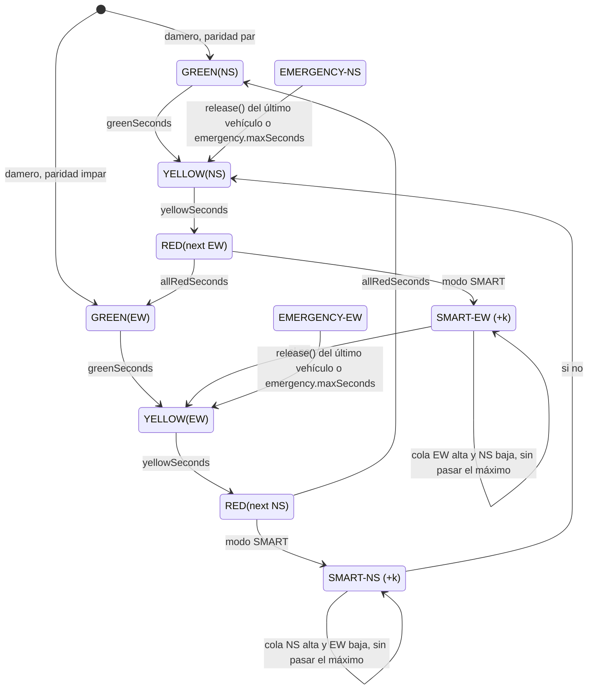
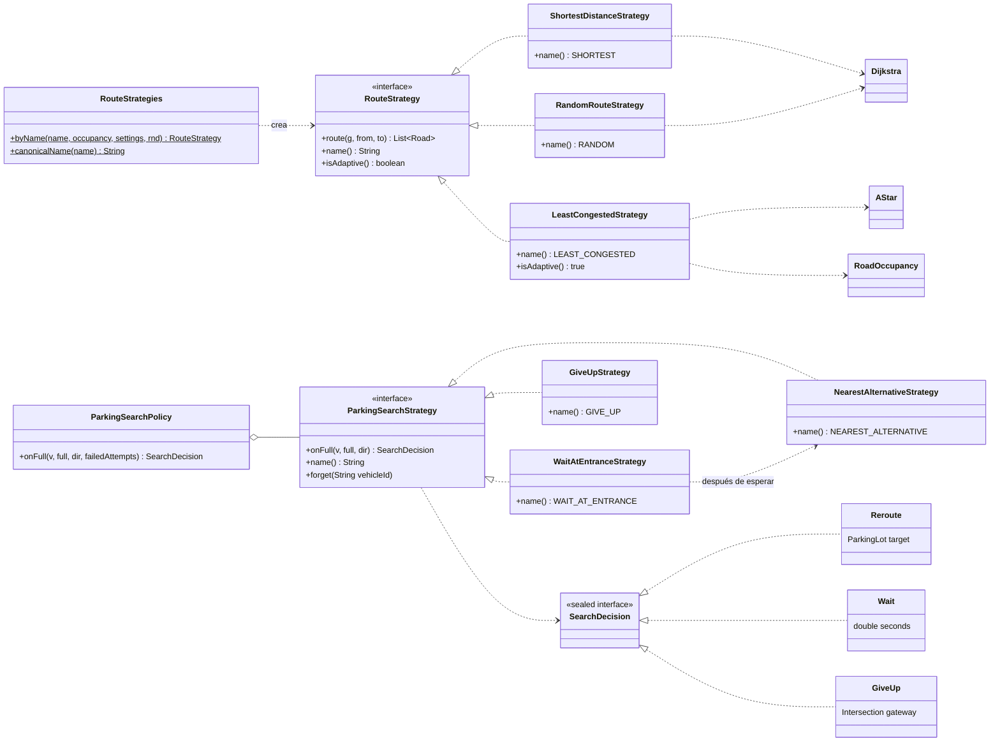

# Patrones y genéricos

ASTRA usa tres patrones de diseño (State, Strategy y Command) y varios tipos genéricos. Agregar un
comportamiento nuevo significa crear una clase nueva, no agregar un `if` o un `switch` por tipo en una
clase existente.

## State: semáforos

Cada `TrafficLight` alterna dos ejes, `Axis.NS` (norte-sur) y `Axis.EW` (este-oeste). `Axis.of(road)`
decide el eje de una vía por su dirección (a 45° cuenta como EW). Cada fase es un `record` inmutable que
implementa `LightState`:

```java
public interface LightState {
    LightColor colorFor(Axis axis);
    Duration duration(LightTimings timings);
    LightState next();
    default boolean canPass(Axis axis) { return colorFor(axis) == LightColor.GREEN; }
    String name();
}
```

`TrafficLight` nunca hace `switch` sobre colores: cada estado decide su color por eje, cuánto dura y
cuál es el siguiente.

| Estado | Color del eje activo | Color del otro eje | Duración | Siguiente | `name()` |
| --- | --- | --- | --- | --- | --- |
| `GreenState(a)` | GREEN | RED | `lights.greenSeconds` (8 s) | `YellowState(a)` | `GREEN(NS)` |
| `YellowState(a)` | YELLOW | RED | `lights.yellowSeconds` (2 s) | `RedState(a.opposite())` | `YELLOW(NS)` |
| `RedState(b)` | RED | RED | `lights.allRedSeconds` (1 s) | `GreenState(b)` | `RED(next EW)` |
| `SmartAdaptiveState(a, k)` | GREEN | RED | `greenSeconds` si `k = 0`; `smart.extensionStepSeconds` (2 s) si `k > 0` | `SmartAdaptiveState(a, k+1)` o `YellowState(a)` | `SMART-NS`, `SMART-NS+1` |
| `EmergencyState(a)` | GREEN | RED | `emergency.maxSeconds` (30 s), límite de seguridad | `YellowState(a)` | `EMERGENCY-NS` |



Desde **cualquier** estado, `preempt(axis, vehicleId)` pasa a `EmergencyState(axis)` (no se dibujan
esas flechas para no saturar el diagrama). Si dos ambulancias piden ejes distintos, gana la última.
`force(axis)` (comando `ForceLightCmd`) pone `GreenState(axis)` y reinicia el ciclo desde ahí.

Detalles del código:

- **Damero.** `LightController` crea semáforo solo en nodos `INTERSECTION` a los que entran 3 o más vías
  de los dos ejes. El primer verde depende de la paridad de la columna y la fila: dos vecinos empiezan
  con ejes opuestos. En `city-3x3-v2.json` son 9 semáforos.
- **Modo SMART.** Con `LightMode.SMART`, `TrafficLight.adapt` reemplaza cada `GreenState` nuevo por
  `SmartAdaptiveState(axis, at, sensor, timings, 0)`. Al vencer, `next()` consulta el `QueueSensor`: si
  la cola del eje en verde es `>= smart.queueThreshold` (5), la del contrario es menor y
  `extensionStepSeconds × (k + 1) <= smart.maxExtensionSeconds` (6 s), extiende otro paso. Con los
  valores por defecto el verde dura como máximo 8 + 3 × 2 = 14 s.
- **Cambio de modo.** `SetLightModeCmd` cambia el modo de `LightController`; cada semáforo lo aplica en
  su próximo verde.
- **Hilos.** `transition` corre en `astra-lights-N`; `preempt` y `release` en `astra-engine` o
  `astra-worker-N`. Todos los cambios pasan por el `ReentrantLock` del semáforo y el estado se publica en
  un `AtomicReference<LightState>`.

## Strategy: rutas y búsqueda de estacionamiento



### Rutas (`routing`)

| Estrategia | Algoritmo | Peso de una vía | Adaptativa |
| --- | --- | --- | --- |
| `ShortestDistanceStrategy` (`SHORTEST`) | Dijkstra | `length` | No |
| `LeastCongestedStrategy` (`LEAST_CONGESTED`) | A* con heurístico euclidiano | `length × (1 + routing.congestionFactor × ocupación)` | Sí: se recalcula en cada intersección |
| `RandomRouteStrategy` (`RANDOM`) | Dijkstra | `length × (1 + U[0,1) × routing.randomJitter)`, sorteado una vez por vía en cada cálculo | No |

- La ocupación de una vía (`RoadOccupancy`, entre 0 y 1) la mide `WorldState` en cada fase C: vehículos
  en la vía dividido por `length / (minGap + largo de un auto) × lanes`, con tope 1.
- Con `isAdaptive() == true`, la fase C llama a `vehicle.reroute(...)` cada vez que el vehículo entra a
  una vía nueva.
- `VehicleSpawner` elige la estrategia de cada vehículo con los pesos `routing.weight.*`
  (0.5 / 0.3 / 0.2) y `SpawnVehicleCmd` la pide por nombre a `RouteStrategies.byName`.

### Búsqueda de estacionamiento (`parking`)

Cuando un auto llega a una playa llena o cerrada, `ParkingService` pide una `SearchDecision` sellada:

| Estrategia | Decisión |
| --- | --- |
| `NearestAlternativeStrategy` | `Reroute` a la playa abierta con lugar más cercana (costo de Dijkstra); si no hay ninguna, `GiveUp` |
| `WaitAtEntranceStrategy` | La primera vez en esa playa, `Wait(parking.waitAtEntranceSeconds)`; si al terminar sigue llena, lo mismo que `NearestAlternativeStrategy` |
| `GiveUpStrategy` | `GiveUp` hacia el gateway más cercano |

`ParkingSearchPolicy` envuelve a la estrategia elegida en `parking.searchStrategy` y aplica el tope:
tras `parking.maxSearchAttempts` (2) llegadas fallidas, el vehículo siempre se rinde. `ParkingService`
resuelve la decisión con un `switch` con *pattern matching* sobre la interfaz sellada.

## Command: acciones del usuario

```java
public interface Command {
    void execute(SimulationEngine engine);          // en astra-engine, al inicio del tick
    default String describe() { return getClass().getSimpleName(); }
}
```

La UI crea los comandos con la fábrica `Commands` y los envía a `CommandBus.submit`. El motor los
ejecuta en orden FIFO al inicio de cada tick. Si un comando lanza una excepción, se registra en el log
y los demás se ejecutan igual. Un comando que decide no hacer nada llama a
`commandBus.markIgnored(motivo)` y queda en el historial como `(ignored: motivo)`. El historial guarda
los últimos 50 (`CommandBus.HISTORY_SIZE`).

| Comando | Fábrica | Qué hace | Se ignora si |
| --- | --- | --- | --- |
| `PauseCmd` | `Commands.pause()` | Pausa la `PauseGate`: congela el mundo, los semáforos y la red | — (idempotente) |
| `ResumeCmd` | `Commands.resume()` | Reanuda la `PauseGate` | — (idempotente) |
| `TogglePauseCmd` | `Commands.togglePause()` | Pausa si corre y reanuda si está en pausa (botón y Espacio) | — |
| `StepCmd(steps)` | `Commands.step()`, `step(n)` | Pide `steps` ticks con el mundo en pausa (1 a 100) | No está en pausa |
| `SetSpeedCmd(factor)` | `Commands.speed(f)` | Cambia el multiplicador de velocidad (0.25 a 4; otro valor lanza `IllegalArgumentException` al crearlo) | — |
| `SpawnVehicleCmd(kind, strategy, origin, dest)` | `Commands.spawn(...)` | Genera un vehículo ya; origen o destino `null` se sortean entre los extremos del mapa | No hay spawner, un id no existe o no es gateway, no hay ruta o espacio, o se llegó a `vehicle.maxCount` |
| `ForceLightCmd(id, axis)` | `Commands.forceLight(id, axis)` | Pone en verde `axis` en el semáforo de `id` | La intersección no existe o no tiene semáforo |
| `SetLightModeCmd(mode)` | `Commands.lightMode(mode)` | Cambia todos los semáforos a `FIXED` o `SMART` | — |
| `SetMutexModeCmd(mode)` | `Commands.mutexMode(mode)` | Cambia en vivo entre `SEMAPHORE` y `RICART_AGRAWALA`; cancela las peticiones pendientes | No hay capa distribuida, o ya estaba en ese modo |

## Genéricos

### `Graph<V, E extends Edge<V>>`

```java
public interface Edge<V> { V from(); V to(); double weight(); }

public class Graph<V, E extends Edge<V>> {
    boolean addVertex(V vertex);
    void addEdge(E edge);
    boolean containsVertex(V vertex);
    List<E> outgoing(V vertex);
    Set<V> vertices();
    List<E> edges();
    int vertexCount();
    int edgeCount();
}
```

- Grafo dirigido. Las listas de adyacencia son `CopyOnWriteArrayList` dentro de un `ConcurrentHashMap`:
  se construye antes de la simulación y después se lee desde cualquier hilo.
- `RoadGraph extends Graph<Intersection, Road>` agrega `findIntersection(id)` y `addTwoWayRoad(...)`,
  que crea `<id>-F` (a → b) y `<id>-B` (b → a).
- `Road` es un `record` que implementa `Edge<Intersection>`; su `weight()` es `length`.

### Dijkstra y A*

```java
public final class Dijkstra<V, E extends Edge<V>> {
    List<E> shortestPath(Graph<V, E> g, V src, V dst);
    List<E> shortestPath(Graph<V, E> g, V src, V dst, ToDoubleFunction<? super E> weight);
    static <E> double totalWeight(List<E> path, ToDoubleFunction<? super E> weight);
}

public final class AStar<V, E extends Edge<V>> {
    List<E> shortestPath(Graph<V, E> g, V src, V dst, ToDoubleBiFunction<? super V, ? super V> heuristic);
    List<E> shortestPath(Graph<V, E> g, V src, V dst, ToDoubleFunction<? super E> weight,
                         ToDoubleBiFunction<? super V, ? super V> heuristic);
    Result<E> search(...);   // record Result<E>(List<E> path, int expanded)
}
```

- Los dos devuelven una lista vacía si `src == dst` o no hay camino, y lanzan
  `IllegalArgumentException` si un vértice no existe o un peso es negativo o NaN.
- Dijkstra es O((V + E) log V). Los dos usan *lazy deletion*: una entrada de la cola superada por una
  distancia mejor se descarta al sacarla.
- `Heuristics.euclidean()` es la distancia en línea recta. Es admisible mientras el largo de cada calle
  sea mayor o igual que la distancia entre sus extremos (en los mapas sin `length`, es igual). El peso de
  `LeastCongestedStrategy` nunca es menor que `length`, así que el heurístico sigue siendo admisible.
- `AStar.search` informa los nodos expandidos; `AStarTest.euclideanExpandsNoMoreNodesThanZeroHeuristic`
  comprueba que el heurístico no expande más que Dijkstra.
- No tienen estado compartido: son seguros desde cualquier hilo.

### `ResourcePool<T>`

Un recurso con `capacity` lugares numerados: un `Semaphore` justo decide si hay lugar sin bloquear y un
arreglo de slots recuerda qué `T` ocupa cada uno. `ParkingLot` lo usa como `ResourcePool<String>` con
el id del vehículo. Ver [Concurrencia](concurrencia.md#cajones-de-las-playas-resourcepoolt).

### Otros genéricos

- `ParallelUpdater.run(List<T> items, IntConsumer plan, IntConsumer move)`.
- `AStar.Result<E>` y los `record` privados de las colas.
- `SimConfig.requireSomeWeight` y `enumValue` para validar pesos y enums de la configuración.

## Colas de prioridad

| Dónde | Tipo | Ordena por |
| --- | --- | --- |
| `Dijkstra.shortestPath` | `PriorityQueue<NodeDist<V>>` | Distancia acumulada desde el origen |
| `AStar.search` | `PriorityQueue<Entry<V>>` | `f = g + h` |

`Request` (`distributed`) implementa `Comparable<Request>` con el orden total `(timestamp, processId)`
que usa Ricart‑Agrawala para decidir si difiere una respuesta. El código de producción lo usa con
`compareTo`, no dentro de una cola; `RequestTest.priorityQueueServesByTimestampThenProcessId` comprueba
que una `PriorityQueue<Request>` lo respeta.

**Pendiente:** el paquete `events` está reservado para una cola de eventos con prioridad, pero no tiene
clases.
