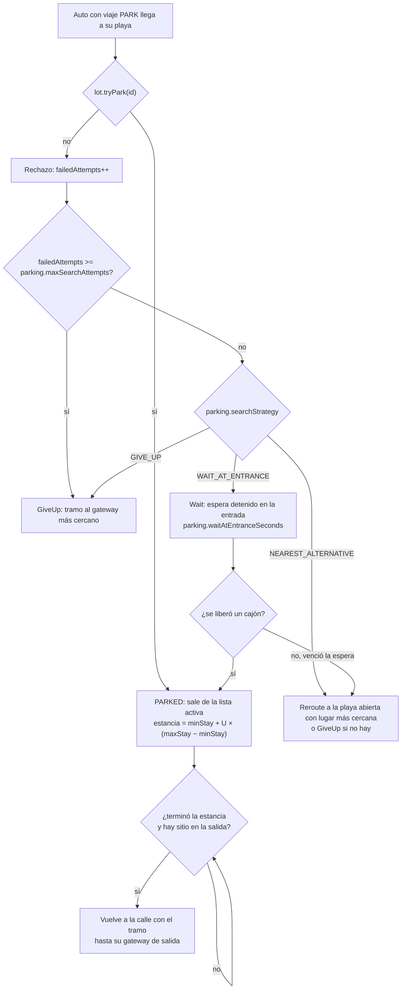

# Modelo de simulación

Este documento describe cómo se mueven los vehículos y cómo se calculan las métricas. Las distancias
están en píxeles del mapa (px), las velocidades en px/s y los tiempos en tiempo simulado, salvo que se
indique otra cosa. Los valores entre paréntesis son los de `config.properties`.

## Tiempo

- El motor avanza en ticks de `engine.tickMillis` (50 ms). Cada tick simula `dt = 0.05 s × velocidad`,
  con la velocidad entre ×0.25 y ×4.
- En pausa el tick sigue contando, pero el mundo y el tiempo simulado no avanzan (ver
  [Concurrencia](concurrencia.md#pausa-sin-bloquear-el-motor)).

## Modelo de conducción

Cada vehículo recorre una ruta de vías consecutivas. `offset` es la posición de su parachoques
delantero sobre la vía actual y `rearOffset = offset − length` la del trasero.

### Distancia libre

En la fase A de cada tick, `WorldState` calcula para cada vehículo cuánto puede avanzar como máximo:

```text
freeDistance = min(gapToLeader, intersectionLimit)
gapToLeader  = rearOffset(del de adelante) − offset − vehicle.minGap      (∞ si es el primero de la vía)
```

`vehicle.minGap` (10 px) es la distancia mínima entre el parachoques delantero de un vehículo y el
trasero del de adelante.

### Línea de detención y reserva de la zona

La línea de detención está a `intersection.stopLineOffset` (14 px) del centro de la intersección. Sea
`toLine = remainingOnRoad − stopLineOffset` la distancia del parachoques delantero a la línea.
`intersectionLimit` sigue estas reglas, en orden:

1. Si el vehículo ya tiene la zona reservada, está comprometido y cruza aunque la luz cambie.
2. Si no la tiene y está lejos (`toLine >= stopLineOffset + intersection.approachMargin`, es decir
   16 px) o la luz no lo deja pasar, el límite es `toLine`: se detiene en la línea.
3. Si la vía siguiente no tiene espacio (`rearOffset` del último en ella − `minGap` < 0), se detiene
   en la línea.
4. Si `IntersectionZone.tryEnter` falla porque la zona está llena (`intersection.capacity` = 2), se
   detiene en la línea.
5. Si otra vía de entrada ya reservó en este tick la misma vía de salida (`entryClaims`), conserva la
   zona pero espera en la línea un tick más.
6. Si todo lo anterior se cumple, el límite es `remainingOnRoad + espacio en la vía siguiente`.

La regla también vale en la última vía: el destino es el centro de un nodo, así que el vehículo respeta
la luz y la zona antes de llegar.

### Regla del amarillo

```text
la luz deja pasar  ⇔  GREEN  o  (YELLOW y toLine < intersection.stopLineOffset)
```

En amarillo solo sigue quien está a menos de 14 px de la línea; los demás se detienen. Un nodo sin
semáforo cuenta como verde.

### Curva de frenado

En la fase B, `Vehicle.update(dt, freeDistance)` ajusta la velocidad:

```text
free     = max(0, freeDistance)
speedCap = min(spec.maxSpeed, road.speedLimit)
target   = min(speedCap, √(2 · spec.deceleration · free))     // velocidad desde la que aún frena dentro de free
speed    = speed < target ? min(target, speed + acceleration · dt)
                          : max(target, speed − deceleration · dt)
step     = min(speed · dt, free)
```

- Si `step` se recorta a `free`, la velocidad pasa a `free / dt`: nunca avanza más que la distancia
  libre.
- Lo que sobra al final de una vía pasa a la siguiente; al terminar la última vía el vehículo queda
  `finished` con velocidad 0.
- En `city-3x3-v2.json` todas las vías tienen `speedLimit` 14, así que ningún vehículo pasa de 14 px/s,
  aunque la ambulancia tenga `maxSpeed` 20.
- Mientras su velocidad es menor que `Vehicle.WAITING_SPEED` (0.5 px/s), el tiempo cuenta como espera.

### Liberación de la zona

En la fase C, un vehículo libera la zona de una intersección cuando ya está en una vía que sale de ella
y su `offset` supera `intersection.boxLength` (16 px). En ese momento también libera la sección de
Ricart‑Agrawala y la preferencia de paso, si las tenía.

## Tipos de vehículo

Cada tipo tiene un `VehicleSpec(maxSpeed, acceleration, deceleration, length)` que `SimConfig.specFor`
arma con las claves `vehicle.<tipo>.*`.

| Tipo | Clase | Id | `maxSpeed` (px/s) | `acceleration` (px/s²) | `deceleration` (px/s²) | `length` (px) | Peso al generar | Particularidad |
| --- | --- | --- | --- | --- | --- | --- | --- | --- |
| Auto | `Car` | `CAR-N` | 14 | 3 | 6 | 12 | 0.75 | El único que puede ir a estacionar |
| Bus | `Bus` | `BUS-N` | 9 | 1.5 | 4 | 20 | 0.20 | — |
| Ambulancia | `Ambulance` | `AMB-N` | 20 | 4 | 8 | 14 | 0.05 | `hasEmergencyPriority()` devuelve `true` |

`VehicleFactory` crea el vehículo de cada tipo con su especificación y la ruta inicial que calcula su
`RouteStrategy`.

## Spawner y gateways

`VehicleSpawner` corre en la fase C de cada tick, en `astra-engine`, y usa una sola semilla
(`spawn.seed` = 42).

- **Extremos.** Si el mapa tiene nodos `GATEWAY`, los vehículos entran y salen solo por ellos (12 en
  `city-3x3-v2.json`). Si no, por las intersecciones del rectángulo exterior.
- **Ritmo.** Cada `spawn.intervalMillis` (6000 ms) de tiempo simulado se programa un grupo de
  `spawn.batchSize` (4) vehículos. Se intenta uno por tick, para que no nazcan uno encima de otro.
- **Límite.** Nunca hay más de `vehicle.maxCount` (150) vehículos en circulación.
- **Sorteo.** Para cada intento elige un tipo con `spawn.weight.*`, una estrategia con
  `routing.weight.*`, un origen y un destino distinto.
- **Viajes a una playa.** Si el tipo es auto, el mapa tiene playas y un sorteo sale menor que
  `parking.tripWeight` (0.35), el auto va a una playa al azar y después sale por el destino sorteado.
- **Espacio.** El vehículo nace en el centro de su nodo de origen. Solo se crea si su primera vía tiene
  sitio (el último en ella tiene `rearOffset >= minGap + length`) y la zona del origen no está llena. Si
  no, el intento se descarta y el tick siguiente sortea otro par.

`SpawnVehicleCmd` usa `spawnNow` para generar un vehículo a pedido; si el mapa tiene gateways, un
extremo explícito debe ser uno.

## Preferencia de paso de la ambulancia

En la fase A, cuando una ambulancia está a `emergency.preemptDistance` (80 px) o menos del final de su
vía y el nodo siguiente tiene semáforo:

1. Suelta la preferencia que tuviera en otra intersección.
2. Llama a `TrafficLight.preempt(axis, id)`: el semáforo pasa a `EmergencyState(axis)`, verde para su
   eje y rojo para el otro.
3. Al salir del box de esa intersección (fase C) llama a `release`. Cuando lo hace la última ambulancia
   que lo pidió, el semáforo sigue con `YellowState(axis)` y el ciclo normal.

La preferencia **solo adelanta el verde**: la ambulancia sigue necesitando reservar la zona con
`tryEnter` y respetar al vehículo de adelante. Si nadie libera el semáforo, `EmergencyState` dura como
máximo `emergency.maxSeconds` (30 s).

## Semáforo SMART

En modo SMART, el verde de cada eje es un `SmartAdaptiveState` (ver
[Patrones](patrones-y-genericos.md#state-semáforos)). La "cola" de un eje es la **demanda**, no solo los
vehículos detenidos: en el eje en verde casi nadie está parado y SMART nunca extendería.

```text
cola(intersección, eje) = vehículos cuya vía termina en esa intersección, con Axis.of(vía) = eje
                          y remainingOnRoad <= smart.queueRadius (120 px)
```

`WorldState` mide las colas al final de cada fase C y las publica en un `AtomicReference`; el semáforo
las lee al vencer cada verde, en `astra-lights-N`, sin bloquear. El verde se alarga
`smart.extensionStepSeconds` (2 s) mientras la cola del eje en verde sea `>= smart.queueThreshold` (5),
la del contrario sea menor y el total no pase `smart.maxExtensionSeconds` (6 s).

`SmartVsFixedIntegrationTest` compara los dos modos en `city-3x3.json`, con el motor secuencial, los
semáforos en tiempo simulado y 5000 ticks: con la semilla 42, SMART espera como mucho un 10 % más que
FIXED, y en promedio sobre las semillas 42, 7, 2026, 99 y 1234 espera menos.

## Estacionamiento

`ParkingService` maneja las llegadas, esperas y salidas de las playas en la fase C, en tiempo simulado.
Solo existe si el mapa tiene nodos `PARKING`.



- **Viajes PARK.** Solo los autos (`TripPurpose.PARK`); buses y ambulancias siempre cruzan la ciudad.
  `Vehicle.destination()` es el final del tramo en curso y `finalDestination()` el gateway de salida.
- **Estancia.** Se sortea entre `parking.minStaySeconds` (20) y `parking.maxStaySeconds` (60) con una
  semilla derivada de `spawn.seed`, y se mide en tiempo simulado: la pausa la congela.
- **Mientras espera** en la entrada, el auto conserva la zona del nodo de la playa y no cuenta nuevos
  rechazos; entra en cuanto se libera un cajón.
- **Salida.** Cuando vence su estancia, el auto vuelve solo si la primera vía tiene sitio y la zona de la
  playa no está llena; si no, lo reintenta en el tick siguiente.
- **Estacionado** no cuenta como "salido": solo cuenta cuando por fin sale por un gateway.
- **Playas cerradas.** `ParkingLot.setOpen(false)` rechaza a todos los que llegan y deja salir a los que
  ya estaban. **Pendiente:** no hay un comando ni un control de la interfaz que lo llame; hoy solo lo
  usan los tests (`ParkingLotTest`, `ParkingSearchStrategyTest`).

## Estadísticas

`SimStats` corre en la fase C y llega a la UI como `StatsView` dentro del snapshot. Los promedios son de
los vehículos que **ya salieron** de la ciudad.

| Métrica | Cálculo | Dónde se ve |
| --- | --- | --- |
| Viaje promedio | Σ `tripSeconds` / llegados | `StatsPanel` |
| Espera promedio | Σ `waitSeconds` / llegados (tiempo con velocidad < 0.5 px/s) | `StatsPanel` y gráfica |
| Espera por tipo | Σ `waitSeconds` del tipo / llegados del tipo | Solo en `StatsView.avgWaitByKind` |
| Throughput | Llegadas de los últimos `stats.throughputWindowSeconds` (60 s) × 60 / ventana, en veh/min | `StatsPanel` y gráfica |
| Cola actual / máx. | Suma de las colas de todas las intersecciones y ejes al final del tick, y su máximo | `StatsPanel` |
| Serie temporal | Un `StatsPoint(simTime, activos, espera promedio, throughput)` cada `stats.sampleSeconds` (1 s), hasta `stats.seriesCapacity` (300) puntos; descarta los más viejos | Las dos gráficas de `StatsPanel` |
| Búsqueda de estacionamiento | Tiempo medio desde la primera llegada a una playa hasta estacionar | Solo en `StatsView.avgParkingSearchSeconds` |
| Rechazos en playas | Llegadas a una playa llena o cerrada | Solo en `StatsView.parkingRejections` |
| Ocupación de playas | Σ ocupados / Σ capacidad de todas las playas, ponderada por tiempo | Solo en `StatsView.avgParkingOccupancy` |

El snapshot también trae los contadores generales: generados (`spawned`), salidos (`despawned`) y
activos por tipo, que muestran el HUD y `StatsPanel`.

**Pendiente:** las tres métricas de estacionamiento y la espera por tipo se calculan pero ningún panel
las muestra.
